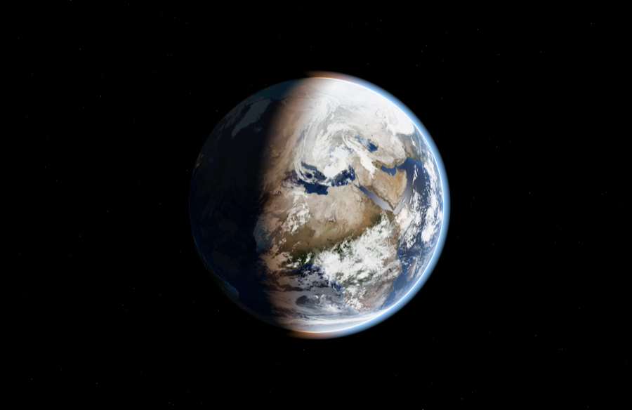
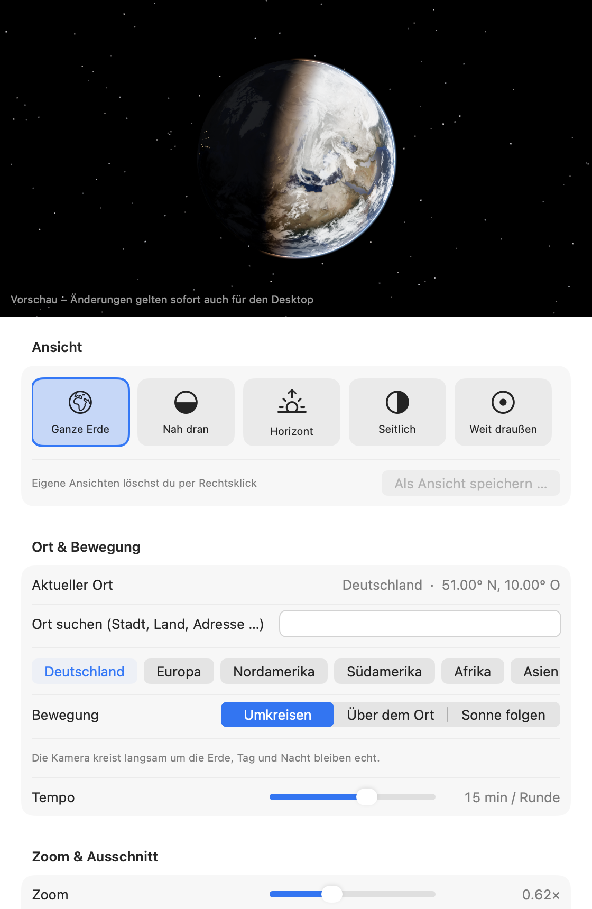

# Live Earth

Animierter Desktop-Hintergrund für macOS: eine 3D-Erde mit **echtem Sonnenstand** – wo gerade Tag ist, ist die Erde hell, wo Nacht ist, leuchten die Städte – und **Live-Wolken**, die alle drei Stunden aktualisiert werden.



## Funktionen

- **Echtzeit-Beleuchtung:** Sonnenstand aus Datum und Uhrzeit berechnet (Genauigkeit ~0,01°), mit Dämmerungszone, Stadtlichtern auf der Nachtseite, Sonnenspiegelung auf den Ozeanen und Atmosphäre.
- **Live-Wolken** aus Satellitendaten, offline automatisch statische Wolken.
- **Ansichten:** Ganze Erde, Nah dran, Horizont, Seitlich (Erde links oder rechts), Weit draußen – plus eigene, gespeicherte Ansichten.
- **Ort:** Suche über Apple Karten; die Kamera fliegt weich zum neuen Ort.
- **Bewegung:** Umkreisen (Tempo einstellbar), über dem Ort stehen oder der Sonne folgen.
- **Sparsam:** Die Bildrate passt sich der tatsächlichen Bewegung an, verdeckte Bildschirme und schlafende Displays pausieren komplett.
- Ein Fenster pro Bildschirm, auf allen Spaces, unter den Desktop-Icons, Klicks gehen durch.



## Bedienung

Nach dem Start erscheint ein Globus-Symbol in der Menüleiste. Darüber wechselst du schnell Ansicht und Bewegung; **Einstellungen …** (⌘,) öffnet das Fenster mit Live-Vorschau. Ein Doppelklick auf die bereits laufende App öffnet ebenfalls die Einstellungen.

## Bauen

Benötigt nur die Xcode Command Line Tools (`xcode-select --install`), kein Xcode.

```bash
./build.sh            # baut LiveEarth.app
open LiveEarth.app
./release.sh 1.0      # baut und verpackt dist/LiveEarth-1.0.dmg
```

`release.sh` signiert und notarisiert, wenn `DEVELOPER_ID` und `NOTARY_PROFILE` gesetzt sind (Details im Skript).

## Projektstruktur

```
app/main.swift        macOS-App: Desktop-Fenster, Menüleiste, Einstellungen (SwiftUI)
web/index.html        Darstellung der Erde (three.js / WebGL, Shader, Sonnenstand)
web/textures/         NASA-Erdtexturen (8K Tag, 4K Nacht) und Hilfstexturen
web/lib/              three.js 0.160.0
build.sh, release.sh  Build und DMG-Paket
```

Die Webseite lässt sich auch im Browser testen: `python3 -m http.server --directory web`, dann z. B.
`http://localhost:8000/?motion=fixed&lat=52.5&lon=13.4&zoom=2.2&pitch=20&hud=1`
(alle Parameter stehen oben in `web/index.html`).

## Vor dem ersten öffentlichen Release

- [ ] Universal-Build (Apple Silicon + Intel) und Mindest-macOS festlegen – aktuell wird nur für den eigenen Mac gebaut
- [ ] Apple Developer Program, dann `release.sh` mit Signatur und Notarisierung
- [ ] Endgültigen Namen und App-Icon festlegen
- [ ] Lizenz für den eigenen Code wählen
- [ ] Wolken-Server-Betreiber informieren bzw. eigenes Hosting (siehe [CREDITS.md](CREDITS.md))

## Credits

Erdbilder: NASA Earth Observatory (Blue Marble, Black Marble). Live-Wolken: [matteason/live-cloud-maps](https://github.com/matteason/live-cloud-maps), *contains modified EUMETSAT data*. 3D: [three.js](https://threejs.org) (MIT). Details in [CREDITS.md](CREDITS.md).
